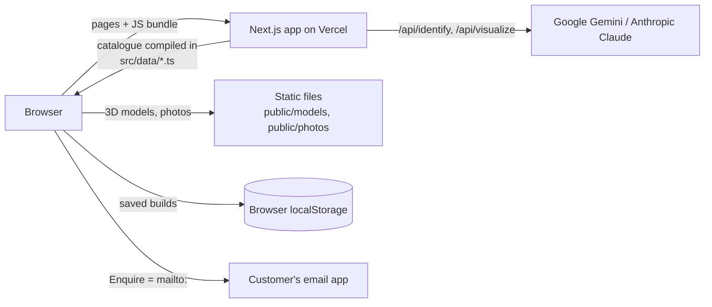
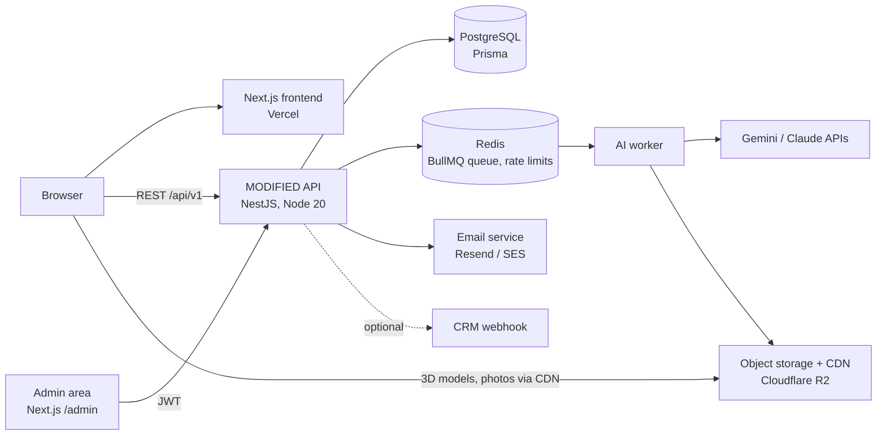

# 2. Architecture

Today everything runs in one Next.js app with the catalogue compiled into the frontend. The proposed
design moves data, pricing, enquiries and AI work to a separate backend API, and keeps the frontend
focused on the 3D experience.

## 2.1 Today (frontend only)

Limits of this setup:

| Problem | Effect |
|---|---|
| Catalogue and prices are in the code | Every price or part change needs a developer and a deploy |
| Builds saved in localStorage | Lost when the customer changes device or clears the browser; cannot be shared |
| Enquiry is a `mailto:` link | No record of leads; depends on the customer sending the email |
| Price calculated in the browser | Can be edited by the customer; no single source of truth |
| AI cap is an in-memory counter | Resets on every restart or new server instance; spending is not really capped |
| 3D files served from the app | Large files in the git repository and in every deploy |

## 2.2 Proposed

### Request flows

**Configure and price**

1. Frontend loads `GET /vehicles/{id}` and `GET /vehicles/{id}/compatibility` (cached by the CDN).
2. The customer changes options; the 3D view updates locally with no server calls.
3. The price shown is the frontend estimate; on Summary, Save or Enquire the frontend calls
   `POST /quotes` and shows the server total.

**Save and share a build**

1. `POST /builds` with the configuration; the API re-prices it and stores it.
2. Response holds a public `shareCode` (`/b/7KQ2XM`) and a private `editToken` kept in localStorage.
3. Anyone with the link opens it read-only; only the edit token can update or delete it.

**Enquire**

1. `POST /enquiries` with contact details, consent and the build (or `buildId`).
2. API stores the lead, emails the studio, optionally posts to a CRM webhook.
3. Staff see and update it in the admin inbox.

**AI photo edit ("See it for real")**

1. Frontend uploads the photo with a pre-signed URL (`POST /uploads`), then calls `POST /ai/visualize`.
2. API checks the spending budget, creates a job, returns `202` with a `jobId`.
3. Worker calls the image model, stores the result, marks the job done.
4. Frontend polls `GET /ai/jobs/{jobId}` (every 2 s, up to 2 min).

## 2.3 Technology choices

| Concern | Choice | Why | Alternatives considered |
|---|---|---|---|
| API framework | **NestJS** (TypeScript, Node 20) | Clear module structure for a growing team; validation, guards and OpenAPI generation built in; same language as the frontend | Next.js route handlers (simpler, but mixes concerns and has short serverless time limits for AI); Express (less structure) |
| Database | **PostgreSQL 16** | Relational data (vehicles × parts × compatibility), strong constraints, JSON columns for configurations | MongoDB (weaker for the compatibility matrix and reporting) |
| ORM | **Prisma** | Typed queries, migrations, readable schema | Drizzle, TypeORM |
| Validation | **class-validator** DTOs (Nest) + shared **Zod** types for the frontend | Same rules on both sides | — |
| Files | **Cloudflare R2** (S3-compatible) + CDN | Cheap egress for large 3D models; pre-signed uploads | AWS S3 + CloudFront |
| Queue and rate limits | **Redis + BullMQ** | AI image jobs take 10–100 s; durable retries; shared counters across instances | Database polling |
| Email | **Resend** (or AWS SES) | Simple API, good deliverability | SMTP |
| Auth (admin only) | Email + password, **JWT** access token (15 min) + refresh token (7 days, rotated) | Small staff team, no SSO needed yet | Clerk / Auth0 (paid) |
| API docs | **OpenAPI 3.1** generated by `@nestjs/swagger`, served at `/docs` | One contract for frontend, backend and testers | — |
| Hosting | Frontend on **Vercel**; API and worker on **Railway** or **Render**; DB on **Neon** or Railway Postgres | Low ops effort for a small team | AWS ECS/RDS (more control, more work) |
| Monitoring | **Sentry** (errors) + structured JSON logs | Find failures fast | Datadog |

## 2.4 Decision log

| # | Decision | Status |
|---|---|---|
| D1 | Separate backend service instead of Next.js API routes | Proposed |
| D2 | PostgreSQL + Prisma | Proposed |
| D3 | Prices calculated only on the server; frontend total is an estimate | Proposed |
| D4 | No customer accounts in release 1; builds use share codes + edit tokens | Proposed |
| D5 | 3D models move from the git repo to object storage + CDN | Proposed |
| D6 | AI calls only from the worker, with a persistent monthly budget | Proposed |
