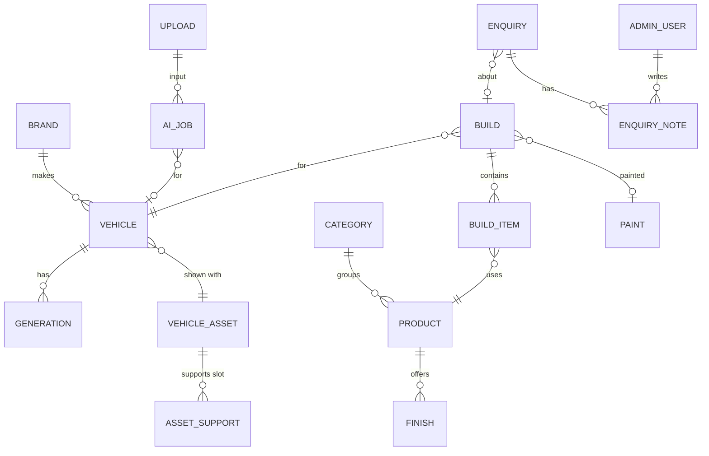

# 3. Data model

PostgreSQL schema for the backend (proposed). It mirrors the data the frontend already uses in
`src/types/vehicle.ts`, `src/types/product.ts` and `src/data/*.ts`, so the catalogue can be migrated
with a one-off seed script.

## 3.1 Entity diagram

## 3.2 Catalogue

**brand**

| Column | Type | Notes |
|---|---|---|
| id | text PK | `porsche`, `volvo` |
| name | text | "Porsche" |
| tagline | text | |
| accent_color | text | hex, used by the UI |
| sort_order | int | |

**vehicle**

| Column | Type | Notes |
|---|---|---|
| id | text PK | `porsche-911`, `volvo-s90` (URL slug) |
| brand_id | text FK → brand | |
| model | text | "911" |
| body | enum `sedan`, `suv`, `coupe` | |
| default_generation | text | "992" |
| base_price | int | INR |
| power | text | "379 hp" |
| asset_id | text FK → vehicle_asset | several vehicles may share one 3D body |
| photo_url | text | CDN URL |
| photo_credit | jsonb | title, artist, licence, source page |
| status | enum `draft`, `published`, `archived` | only `published` is public |
| created_at, updated_at | timestamptz | |

**generation**

| Column | Type | Notes |
|---|---|---|
| id | uuid PK | |
| vehicle_id | text FK | |
| code | text | "991", "992" |
| label | text | "992 (2019–present)" |
| year_from, year_to | int | |

**vehicle_asset** (one 3D model and how to use it)

| Column | Type | Notes |
|---|---|---|
| id | text PK | `volvo-s90-v3` |
| label | text | |
| model_url | text | CDN URL of the GLB |
| file_size_bytes | int | for the size budget |
| gpu_texture_mb | numeric | from the pipeline report |
| stand_in | boolean | true for generic bodies |
| config | jsonb | everything the 3D viewer needs that is not relational: `forward`, `scale`, wheel nodes, attachment points, surfaces, opening panels (`doors`), `cabin`, `interior` sets, `factoryPaint`, `groundShadow`, `defaultLighting`. Same shape as `VehicleAssetConfig` today. |
| credit | text | licence credit line |
| licence | text | `CC BY-SA 4.0`, `CGTrader Royalty Free`, … |
| licence_checked | boolean | must be true before `published` |

**asset_support** (what each 3D body can show)

| Column | Type | Notes |
|---|---|---|
| asset_id | text FK | composite PK with `component` |
| component | text | `wheels`, `spoiler`, `exhaust`, `interior`, … |
| support | enum `replace`, `attach`, `material`, `none` | |
| note | text | shown when `none` |

**category**

| Column | Type | Notes |
|---|---|---|
| id | text PK | `wheels`, `spoilers`, `bumpers`, `skirts`, `lighting`, `accessories`, `interior` |
| name, blurb | text | |
| sort_order | int | |

**product**

| Column | Type | Notes |
|---|---|---|
| id | text PK | `wheels-amg-twin` |
| category_id | text FK | |
| slot | enum (14 slots, see `SlotId`) | one product per slot in a build |
| component | text | matched against `asset_support.component` |
| name, description | text | |
| price | int | INR |
| impl | jsonb | how the viewer realises it: `{kind:'wheels', model}`, `{kind:'attach', model, attachment, span}`, `{kind:'material', overrides}`, `{kind:'interior', set}` |
| thumb | jsonb | thumbnail kind and design |
| default_finish_id | text | |
| status | enum `draft`, `published`, `archived` | |

**finish**

| Column | Type | Notes |
|---|---|---|
| id | text | composite PK with `product_id` |
| product_id | text FK | |
| name | text | "Satin Bronze" |
| color | text | hex |
| metalness, roughness, clearcoat | numeric | |
| price | int | extra over the product price, INR |

**paint**

| Column | Type | Notes |
|---|---|---|
| id | text PK | `factory`, `racing-red`, `custom` |
| name | text | |
| color | text | hex |
| metalness, roughness, clearcoat, clearcoat_roughness | numeric | |
| price | int | INR; `custom` = paint-to-sample price |

## 3.3 Builds and leads

**build** (a saved configuration)

| Column | Type | Notes |
|---|---|---|
| id | uuid PK | |
| share_code | text unique | 6–8 characters, e.g. `7KQ2XM` |
| edit_token_hash | text | SHA-256 of the edit token; the token itself is never stored |
| vehicle_id | text FK | |
| generation_code | text | |
| year | int | |
| paint | jsonb | `{id, color?, finish?}` |
| total | int | server-calculated, INR |
| price_version | int | catalogue price version used for `total` |
| created_at, updated_at | timestamptz | |
| expires_at | timestamptz | null = keep; anonymous builds untouched for 12 months can be purged |

**build_item**

| Column | Type | Notes |
|---|---|---|
| build_id | uuid FK | composite PK with `slot` |
| slot | enum | |
| product_id | text FK | |
| finish_id | text | |
| unit_price | int | price at save time, INR |

**enquiry** (a lead)

| Column | Type | Notes |
|---|---|---|
| id | uuid PK | |
| reference | text unique | human reference, `ENQ-2026-000123` |
| build_id | uuid FK nullable | |
| build_snapshot | jsonb | full configuration and line items at enquiry time (prices can change later) |
| name | text | |
| email | text | |
| phone | text | E.164 |
| city | text | |
| preferred_contact | enum `phone`, `email`, `whatsapp` | |
| message | text | max 2,000 characters |
| consent_marketing | boolean | |
| consent_at | timestamptz | |
| source | text | `configurator`, `identify`, `visualize` |
| utm | jsonb | campaign tags |
| status | enum `new`, `contacted`, `quoted`, `won`, `lost`, `spam` | |
| assigned_to | uuid FK → admin_user | |
| created_at, updated_at | timestamptz | |

**enquiry_note**: id, enquiry_id, author_id, body, created_at.

## 3.4 Uploads, AI and admin

**upload**: id, kind (`identify_photo`, `visualize_photo`, `asset_model`, `vehicle_photo`), storage_key,
media_type, size_bytes, created_at, expires_at (customer photos: 24 h).

**ai_job**

| Column | Type | Notes |
|---|---|---|
| id | uuid PK | |
| kind | enum `identify`, `visualize` | |
| status | enum `queued`, `running`, `succeeded`, `failed` | |
| input | jsonb | upload ids, vehicle id, configuration |
| result | jsonb | identify result, or output image key |
| provider, model | text | `gemini`, `gemini-3.1-flash-image` |
| cost_usd | numeric(10,4) | estimated cost of the call |
| error_code | text | |
| client_fingerprint | text | hashed IP + user agent, for per-visitor limits |
| created_at, finished_at | timestamptz | |

**admin_user**: id, email (unique), name, password_hash (argon2id), role (`admin`, `staff`),
last_login_at, disabled.

**refresh_token**: id, user_id, token_hash, expires_at, revoked_at.

**audit_log**: id, actor_id, action (`product.update`, …), entity, entity_id, before, after, created_at.

## 3.5 Indexes and rules

- `vehicle (brand_id, status)`, `product (category_id, slot, status)`, `enquiry (status, created_at desc)`,
  `ai_job (status, created_at)`, `build (share_code)` unique.
- A build may hold at most one item per slot (composite primary key).
- A product can be added to a build only if the vehicle's asset supports its `component`
  (or it is accepted as "preview only"; the API returns that flag).
- Prices are integers in INR; totals are always recalculated on the server.
