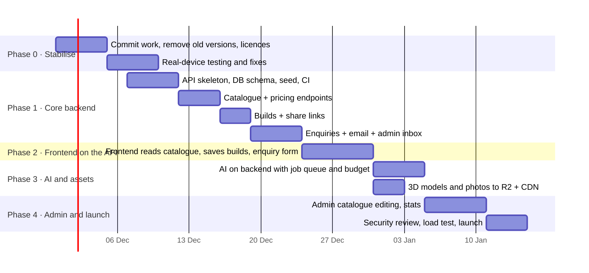

# 8. Roadmap

Plan for one lead, one designer and one backend/frontend developer. Estimates assume the developer
works full time on this project; they move if the scope decisions in the product overview change.

## 8.1 Phases

| Phase | Outcome | Effort (developer days) |
|---|---|---|
| 0. Stabilise | Clean repository; only final car versions; licences confirmed; works on iPhone, Android and a laptop | 5–10 |
| 1. Core backend | API running on staging: catalogue, pricing, saved builds, enquiries with email and admin inbox | 15–17 |
| 2. Frontend on the API | Website reads the catalogue from the API, saves shareable builds, sends real enquiries | 5–7 |
| 3. AI and assets | AI features behind the backend with a monthly cap; 3D files served from the CDN | 6–8 |
| 4. Admin and launch | Staff can edit cars, parts and prices; security review; production launch | 8–10 |
| **Total** | | **about 40–50 developer days (8–10 weeks)** |

## 8.2 Milestones

| Milestone | Definition of done | Target |
|---|---|---|
| M0 Demo-ready | Phase 0 done; demo link safe to show clients | 2 weeks |
| M1 First backend | Enquiries stored and emailed; builds shareable by link | 5 weeks |
| M2 Beta | Frontend fully on the API; AI capped; staging tested by the team | 7 weeks |
| M3 Launch | Admin editing, security review passed, production live | 9–10 weeks |

## 8.3 Who does what

| Person | Phase 0 | Phase 1–2 | Phase 3–4 |
|---|---|---|---|
| Lead | Cleanup, licences, scope decisions | API review, priorities, client feedback | 3D pipeline for new cars, launch checklist |
| Designer | Figma file for current pages | Enquiry form, confirmation, share page, empty and error states | Admin screens, launch visuals |
| Developer | Real-device testing and fixes | Backend modules, frontend integration | AI queue, CDN move, admin, tests |

## 8.4 Risks

| Risk | Impact | Mitigation |
|---|---|---|
| Volvo model licence does not allow commercial use | Must replace the car | Check now; budget for a paid model |
| Only 3 cars are truly 3D | Clients expect their car | Agree a launch list; plan 1–2 days per new car |
| Low-end phones struggle with 3D | Lost customers | Size budgets (section 6.1); lighter mode for phones |
| AI costs grow with traffic | Unplanned spend | Monthly cap and per-visitor limits |
| One developer | Delays when unavailable | Docs, small pull requests, reviews by the lead |
